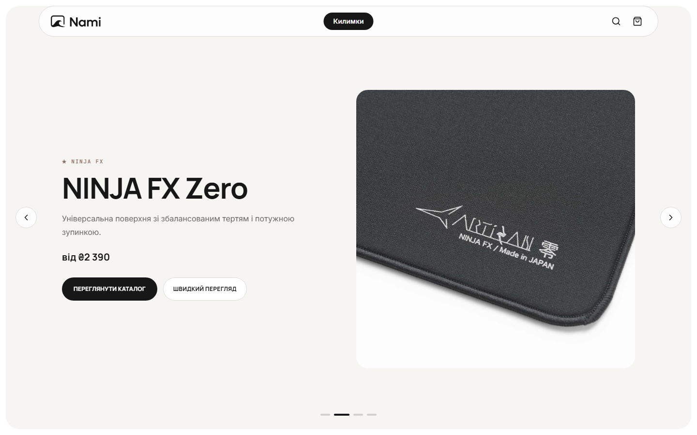

# Nami Gear

🌐 **Live:** [nami.wtf](https://nami.wtf)

E-commerce store for gaming mousepads and glides.



**Stack:** Next.js 16 · TypeScript · Neon PostgreSQL · Zustand · TanStack Query · Tailwind CSS 4 · Cloudinary

## Features

- Product catalog and stock stored in Neon PostgreSQL, kept in sync with TanStack Query
- Persistent cart with Zustand, checkout and orders via Next.js Route Handlers
- Nova Poshta delivery, Monobank payment integration and Telegram order notifications
- Images served through Cloudinary, branded Open Graph previews

## Getting started

Requirements: Node.js 20+, a PostgreSQL database (e.g. Neon).

```bash
npm install
cp .env.example .env.local    # database, Nova Poshta, Monobank, Telegram keys
npm run db:init
npm run dev
```

Checks: `npm run typecheck`, `npm run lint`.
